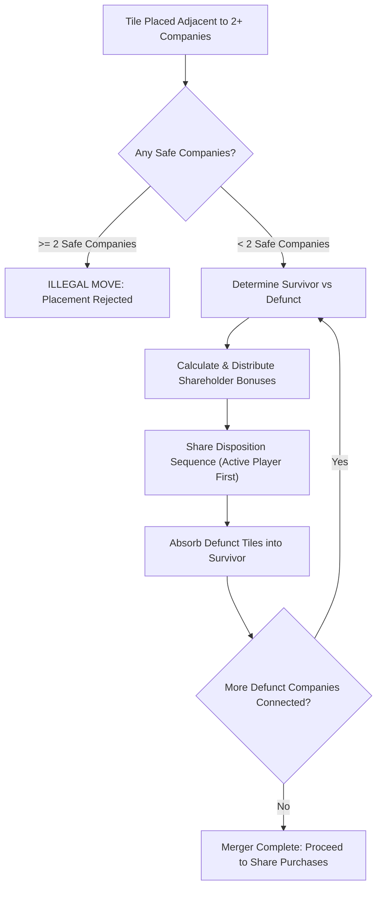
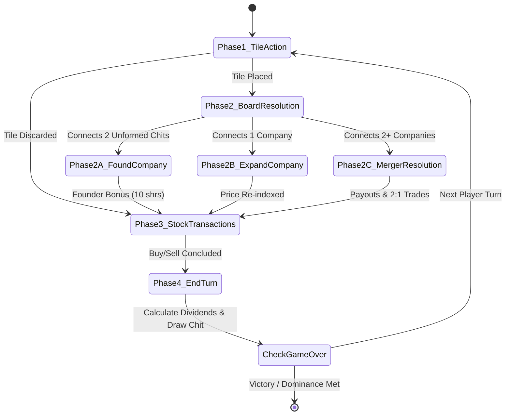

# Oil Baron — Authoritative Game Rules & Mathematical Specification

> **Source Specification & Reverse-Engineering Basis**  
> Extracted and verified from the 16-bit Windows 3.1 New Executable binary `OILBARON.EXE` (Version 1.2, May 1993, by Al Funk), decompiled with Ghidra from Turbo Pascal for Windows 1.5. All constants, memory offsets, algorithms, and decision heuristics are cited with their corresponding decompiled C routines from `decompile/src/` (`board_logic.c`, `company_and_stocks.c`, `mergers.c`, `ai.c`, `dialogs.c`, `main_winproc.c`, `data_tables.c`) and embedded resources (`help_text.txt`, `dialogs.rc`, `exe_strings.txt`).

---

## 1. Board & Grid Architecture

### 1.1 Geometry & Dimensions
The game board is a discrete two-dimensional grid of cells:
- **Columns**: Horizontal coordinate from `1` to `N` (1-indexed). Minimum is $12$, maximum is $26$, default is **$12$** (`BOARD_DEFAULT_COLS`, `DAT_10a8_22b6`).
- **Rows**: Vertical coordinate represented by letters from `'A'` to `'Z'`. Minimum is $12$ (`'L'`), maximum is $26$ (`'Z'`), default is **$12$** (`'L'`) (`BOARD_DEFAULT_ROWS`, `DAT_10a8_22b2`).
- **Grid Capacity**: Standard grid has $12 \times 12 = 144$ squares. Maximum grid allows up to $26 \times 26 = 676$ squares.

### 1.2 Memory Model & Coordinate Mapping
Coordinates in memory follow a row-major structure located in DGROUP at `DAT_10a8_22d2`:
- **Cell Address Calculation**:
  $$\text{Address}(R, C) = \text{DAT\_10a8\_22d2} + (\text{Row} - 1) \times 140 + (\text{Col} - 1) \times 5$$
  - Row Stride: `0x8c` ($140$ bytes)
  - Cell Stride: `5` bytes (1-byte state tag + 4-byte widget control pointer at `DAT_10a8_22d0`)
  - Row conversion: Letter ASCII value minus `0x41` (`'A'` $\to 0$).

### 1.3 Cell Encoding Table
Grid cells are encoded as 8-bit integers (`exe_strings.txt`, `board_logic.c`):

| ID | Constant | Name | Description | Bitmap Resource |
|---|---|---|---|---|
| `0` | `COMPANY_NONE` | Empty | Unoccupied board square | `NONE` |
| `1` | `COMPANY_IMPERIAL` | Imperial | Imperial Oil and Gas | `IMPERIAL` |
| `2` | `COMPANY_ROYAL` | Royal (Colored Cube) | Colored Cube Oil Co. | `ROYAL` |
| `3` | `COMPANY_AMERICAN` | American | American Natural Gas Co. | `AMERICAN` |
| `4` | `COMPANY_ARABIAN` | Arabian | Oil Arabia, Inc. | `ARABIAN` |
| `5` | `COMPANY_TOWER` | Tower (Pyramid) | Pyramid Oil Co. | `TOWER` |
| `6` | `COMPANY_SUPRA` | SupraCo | SupraCo Fuel Resources | `SUPRA` |
| `7` | `COMPANY_WEEMOCO` | Weemoco | Weem Oil Refining | `WEEMOCO` |
| `8` | `TILE_PURPLE` | Purple | Unformed single placed chit (or 8th company identity) | `PURPLE` |
| `9` | `TILE_BLANK` | Blank / Dead | Placed blank tile or dead unplayable marker (`'\t'`) | `BLANK` |
| `10`| `TILE_DISCARD` | Discard Square | Square where a discarded chit was surrendered (`'X'`) | `DISCARD_SQUARE` |

### 1.4 Player Hands & Tile Pool
- **Hand Size (`DAT_10a8_22ae`)**: Configurable between $1$ and $14$ chits (default: **$6$ chits**).
- **Draw Pool**: Initially populated with all $Rows \times Cols$ unique coordinates shuffled in random order (`FUN_1008_1e95`).
- **Draw Mechanism (`FUN_1008_21eb`)**: Whenever a player plays or discards a tile, a new tile is drawn from the pool into the empty slot in the player's hand.
- **Blank Chits (`Blanks = TRUE`)**: If enabled in game options, special wildcard tiles ("Blank Pieces") can be drawn. A blank piece may be placed on any vacant square on the board, removing that square's corresponding tile from the game pool.

---

## 2. Company Profiles, Tiers & Valuation Model

Oil Baron features up to 8 corporate entities grouped into 3 distinct financial tiers (`help_text.txt`, `FUN_1048_10c1`, `FUN_1008_4c3f`).

### 2.1 Corporate Identity & Tier Matrix

| ID | Display Name | Internal Name / Insignia | Pricing Tier | Base Price ($P_0$) | Growth Increment ($\Delta P$) | Dividend Yield | Safe Threshold |
|---|---|---|---|---|---|---|---|
| **1** | Imperial | Imperial Oil and Gas | **High Tier** | \$40.00 | \$2.00 / tile | High (12.5% base) | 11 tiles |
| **2** | Colored Cube (Royal) | Colored Cube Oil Co. | **High Tier** | \$40.00 | \$2.00 / tile | High (12.5% base) | 11 tiles |
| **3** | American | American Natural Gas Co. | **Mid Tier** | \$20.00 | \$2.00 / tile | Medium (10.0% base) | 11 tiles |
| **4** | Arabian | Oil Arabia, Inc. | **Mid Tier** | \$20.00 | \$2.00 / tile | Medium (10.0% base) | 11 tiles |
| **5** | Pyramid (Tower) | Pyramid Oil Co. | **Mid Tier** | \$20.00 | \$2.00 / tile | Medium (10.0% base) | 11 tiles |
| **6** | SupraCo | SupraCo Fuel Resources | **Low Tier** | \$7.50 | \$1.50 / tile | Low/Standard (6.7% base) | 11 tiles |
| **7** | Weemoco | Weem Oil Refining | **Low Tier** | \$7.50 | \$1.50 / tile | Low/Standard (6.7% base) | 11 tiles |
| **8** | Purple | Purple Oil Company, Int. | **Low Tier** | \$7.50 | \$1.50 / tile | Low/Standard (6.7% base) | 11 tiles |

> [!NOTE]
> In classic *Acquire*, only 7 companies exist (Tower, Luxor, American, Worldwide, Festival, Imperial, Continental). In *Oil Baron*, an 8th identity ("Purple Oil Company", ID `8`) exists within the binary data tables, bitmap assets, and help documentation (`help_text.txt`). Placed unformed chits use value `8` (`PURPLE`) or `9` (`'\t'`).

### 2.2 Share Limits & Founder Bonus
- **Total Shares per Company (`DAT_10a8_22be`, `DAT_10a8_22c0`)**:
  - In standard rule sets: **25 shares** per company.
  - In *Oil Baron* options (`ShareLimitNumber`): Configurable from **$500$** up to **$10,000,000$** shares (default: $500$ or unconstrained).
- **Hard Share Limits (`HardShare = TRUE`)**:
  - When enabled, trading into a company via merger is strictly capped at the share limit.
  - When disabled, share limits can be exceeded via merger 2-for-1 trades; however, once sold, surplus shares cannot be repurchased.
- **Founder Share Bonus (`FUN_1008_51fd`)**:
  - When a player places a tile adjacent to an independent unformed chit, a new company is established (`CHOOSE COMPANY` dialog).
  - The founding player immediately receives **10 free shares** in the newly created company (assembly code: `shares[company] = shares[company] + 10`).

### 2.3 Safe Company Threshold
- A company is deemed **Safe** (immune from hostile takeover or merger liquidation) as soon as its active tile count reaches **$11$ tiles** (`SAFE_COMPANY_THRESHOLD = 11`):
  $$\text{Safe}(C) \iff \text{Size}(C) \ge 11$$
- Two safe companies can never be merged. A tile whose placement would link two safe companies is deemed **unplayable** / illegal.

---

## 3. Stock Market & Pricing Engine

### 3.1 Linear Share Pricing Formula
Share price appreciates as additional contiguous tiles expand the company's territory (`FUN_1008_4c3f`, `board_logic.c`):
$$\text{Price}(S) = P_0 + (S - 2) \times \Delta P$$
where:
- $S$ is the company's active territory tile count ($S \ge 2$).
- $P_0$ is the starting base price at formation ($S = 2$).
- $\Delta P$ is the fixed dollar increment per chit added.

#### Standard Baseline Price Curve Matrix

| Tile Count ($S$) | Low Tier (Supra, Weem, Purple) | Mid Tier (American, Arabian, Pyramid) | High Tier (Imperial, Colored Cube) |
|---|---|---|---|
| **2** (Formed) | \$7.50 | \$20.00 | \$40.00 |
| **3** | \$9.00 | \$22.00 | \$42.00 |
| **4** | \$10.50 | \$24.00 | \$44.00 |
| **5** | \$12.00 | \$26.00 | \$46.00 |
| **6** | \$13.50 | \$28.00 | \$48.00 |
| **7** | \$15.00 | \$30.00 | \$50.00 |
| **8** | \$16.50 | \$32.00 | \$52.00 |
| **9** | \$18.00 | \$34.00 | \$54.00 |
| **10** | \$19.50 | \$36.00 | \$56.00 |
| **11** (Safe) | \$21.00 | \$38.00 | \$58.00 |
| **20** | \$34.50 | \$56.00 | \$76.00 |
| **30** | \$49.50 | \$76.00 | \$96.00 |
| **40** | \$64.50 | \$96.00 | \$116.00 |

*(Note: When bracket lookup mode `STOCK_PRICE_CURVE` in `data_tables.c` is active, prices scale at \$200, \$300, \$400 baselines per 10-tile bracket).*

### 3.2 Player Cash Reserves
- **Starting Cash (`DAT_10a8_22ba`, `DAT_10a8_22bc`)**:
  - Minimum allowed: **\$250**.
  - Default starting balance: **\$6,000** (`0x6000`).
- **Dividends (`FUN_1008_23d1`)**:
  - If `PayDividends` is enabled, dividends are paid to all players at the end of every turn:
    $$\text{Payout} = \sum_{C=1}^{8} \text{Shares Held}_C \times \text{Dividend Rate}_C$$
  - High tier companies (Imperial, Colored Cube) pay substantially higher dividend rates relative to their share price.

### 3.3 Purchasing Limits
- Configurable via options (`Purchaselimit = TRUE`, `DAT_10a8_3dd2`).
- Setting a purchasing limit restricts a player to buying at most $L$ shares per company per turn (standard Acquire rule: up to **3 shares per turn**; Oil Baron options allow minimum $100$ when configured).
- **Repurchase Allowance**: Shares sold during the current turn may be repurchased within the same turn without counting against the purchasing limit.

---

## 4. Merger Mechanics & Resolution Sequence

A merger occurs whenever a placed tile bridges two or more distinct corporate chains (`FUN_1008_2448`).

### 4.1 Survivor Determination & Tie-Breaking
1. **Size / Value Rule**:
   - The company with the larger territory size (or higher share price) survives.
   - The smaller company becomes defunct and its territory is absorbed into the survivor.
2. **Tie-Breaking Rule (`FUN_1008_2448:183-192`)**:
   - If two merging companies have identical sizes / share prices:
     $$\text{Survivor} = \text{Company of the newly placed chit}$$
   - The newly placed tile's native company does not swap out, resolving equal-value ties deterministically in favor of the active player's placed chain.

### 4.2 Shareholder Bonus Formulas (`FUN_1008_50e3`, `mergers.c:280-345`)
When a company becomes defunct, cash bonuses are paid to its primary and secondary shareholders based on its pre-merger share price ($P_{\text{defunct}}$):

$$\text{Majority Bonus Pool} = 10 \times P_{\text{defunct}}$$
$$\text{Minority Bonus Pool} = 5 \times P_{\text{defunct}}$$

#### Tie-Splitting & Distribution Rules

1. **Uncontested Majority & Minority**:
   - Sole 1st place shareholder receives: $10 \times P_{\text{defunct}}$
   - Sole 2nd place shareholder receives: $5 \times P_{\text{defunct}}$
2. **Tied for 1st Place (Majority Tie)**:
   - If $N$ players tie for largest shareholding ($N \ge 2$):
     - The Majority bonus is split equally among the $N$ tied players:
       $$\text{Bonus per Player} = \frac{10 \times P_{\text{defunct}}}{N}$$
     - In accordance with standard rules, the Minority bonus is **cancelled / not awarded** (or combined and divided depending on variant).
3. **Tied for 2nd Place (Minority Tie)**:
   - Sole 1st place receives $10 \times P_{\text{defunct}}$.
   - $M$ players tie for 2nd place ($M \ge 2$):
     $$\text{Bonus per Player} = \frac{5 \times P_{\text{defunct}}}{M}$$
4. **Single Shareholder (Complete Monopoly)**:
   - If only one player owns shares in the defunct company, that player receives **both** majority and minority bonuses:
     $$\text{Total Bonus} = 15 \times P_{\text{defunct}}$$

### 4.3 Share Disposition (`mergers.c:391-470`)
After bonuses are paid, each shareholder in turn (beginning with the **current active player**, then clockwise / in player index order) decides what to do with their defunct shares via the `KEEP_SHARES` dialog:

1. **HOLD / KEEP**:
   - Keep shares in portfolio.
   - Defunct shares produce no dividends and cannot be sold on normal turns until that company is re-formed.
2. **SELL**:
   - Liquidate shares at the defunct company's pre-merger price ($P_{\text{defunct}}$) for immediate cash.
3. **TRADE (2-for-1)**:
   - Exchange **2 shares of the defunct company for 1 share of the surviving company**.
   - Traded shares are drawn from the remaining unsold stock of the surviving company.
   - If `HardShare` limits are active and surviving stock is exhausted, remaining shares must be kept or sold.
4. **Partial Combination**:
   - Players may freely allocate a portion of their holdings to keep, sell, and trade.

### 4.4 Cascade / Multi-Company Mergers
When a tile bridges $3$ or $4$ companies simultaneously:
- The single largest company survives.
- Defunct companies are liquidated one at a time recursively (`mergers.c:593`).
- Each defunct chain awards majority/minority bonuses and resolves share disposition before the next defunct chain is processed.
- The surviving company grows in size after each liquidation, increasing its share price before subsequent trade ratios are evaluated.

---

## 5. Turn Loop State Machine

Each player's turn follows an authoritative four-state loop (`company_and_stocks.c:1850-2022`):

### Phase 1: Tile Placement / Discard
- The active player selects a chit from their hand:
  - **Place Chit**: Placed on the designated board coordinate (`FUN_1008_9c3e`).
  - **Discard Chit**: If all hand tiles are dead / unplayable, or disadvantageous, player discards the chit (`FUN_1050_0002`). Discarded tiles are permanently removed from play.
  - **Play Blank**: If player holds a Blank wildcard, player may designate any unoccupied cell (`BLANK_MOVE` dialog).

### Phase 2: Board Resolution
- **Solo Chit**: Placed chit does not touch any other chits $\to$ turns into single unformed chit (`TILE_PURPLE`, ID `8`).
- **Found Company**: Chit touches one or more single unformed chits $\to$ active player chooses company name (`CHOOSE COMPANY`), receives 10 free founder shares, and all adjacent unformed chits adopt the company insignia (`FUN_1008_51fd`).
- **Expand Company**: Chit touches an existing company $\to$ company absorbs cell, size increases by 1, share price re-indexes upward (`FUN_1008_4c3f`).
- **Trigger Merger**: Chit bridges 2 or more active companies $\to$ triggers merger resolution sequence (`FUN_1008_2448`).

### Phase 3: Stock Transactions (`SHARES DIALOG`)
- Active player may buy or sell shares in any currently founded companies on the board.
- Standard limit: Up to 3 shares per turn (or subject to game options `PurchaseLimitNumber`).
- Cash is debited immediately upon purchase; shares are credited to portfolio.

### Phase 4: End Turn & Dividend Payout
- Player signals end of turn (Alt+E or Button Bar "Next Turn").
- **Draw**: A replacement chit is drawn from the pool into the player's hand (`FUN_1008_21eb`).
- **Dividends**: If `PayDividends` is active, player collects dividends for all active shares (`FUN_1008_23d1`).
- **End-Game Verification**: Engine evaluates termination conditions (`FUN_1008_7591`).
- **Turn Advance**: Active player pointer advances to the next player (`DAT_10a8_319a`).

### 5.1 End Game & Victory Conditions (`FUN_1008_7591`, `FUN_1008_35ac`)
The game immediately terminates when either condition is satisfied:
1. **Board Dominance**: One company dominates the board and no further companies can legally be created (`FUN_1008_7591`).
2. **Safe Companies Threshold**: All active companies on the board have reached safe status ($\text{Size} \ge 11$), OR any single company reaches $\text{Size} \ge 41$.
3. **Draw Pool Exhaustion**: All pool tiles are drawn, and players have completed rounds equal to half their allotted chit count ($\text{Rounds} \ge \lfloor \text{Chits} / 2 \rfloor$).

#### Final Scoring & Liquidation (`FUN_1008_35ac`)
1. Majority and minority bonuses are awarded for all surviving companies on the board.
2. All players' stock portfolios are fully liquidated at current market value:
   $$\text{Final Wealth} = \text{Cash} + \sum_{C=1}^{8} \text{Shares}_C \times \text{Final Price}_C$$
3. Players are ranked by Total Wealth. The player with the highest wealth is crowned the **Oil Baron**.

---

## 6. Artificial Intelligence Decision Heuristics

The AI engine in `ai.c` models computer players with two difficulty levels (`type = 2` Dumb AI, `type = 3` Smart AI).

### 6.1 Tile Placement Evaluation (`FUN_1008_a397`)
The AI evaluates every tile in its hand across four tactical dimensions:

1. **Company Growth Weighting ($W_{\text{growth}}$)**:
   For existing companies, expanding the company is scored based on current tile count:
   $$W_{\text{growth}}(\text{Size}) = \begin{cases} 
   5 & \text{if Size} = 2 \\
   7 & \text{if Size} = 3 \\
   8 & \text{if Size} = 4 \\
   10 & \text{if } 5 \le \text{Size} \le 7 \\
   15 & \text{if } 8 \le \text{Size} \le 10 \\
   0 & \text{if Size} \ge 11 \text{ (Already Safe)}
   \end{cases}$$
   *Rationale*: Chains between 8 and 10 tiles receive highest urgency (15) to push them over the safe threshold of 11. Once safe ($\ge 11$), growth urgency drops to 0.

2. **Perimeter Expansion Score (`FUN_1008_813e`)**:
   The AI counts open adjacent squares surrounding candidate companies. Companies with open perimeters are preferred over boxed-in chains.

3. **Founding Urgency**:
   Founding a new company scores high priority, especially for High Tier companies (Imperial, Colored Cube), maximizing the capital gain from the 10 free founder shares.

4. **Merger Initiation Evaluation (`FUN_1008_88d9`)**:
   Before placing a tile that causes a merger, the AI simulates:
   - Whether it holds the majority in the defunct company (to claim the 10x bonus).
   - The trade profit from exchanging 2 defunct shares into 1 surviving share.
   - If the AI would lose majority or suffer net worth destruction, the tile placement is suppressed.

### 6.2 Stock Purchasing Priority (`FUN_1008_bbb8`, `ai.c:516-700`)
On each turn, the AI ranks all active companies and buys up to 3 shares:
1. **Majority Defense (`FUN_1008_a13c`)**:
   The AI inspects competing players' share counts. If another player is within 2 shares of taking the majority bonus, the AI prioritizes buying shares in that company to protect its 10x payout.
2. **Growth Rate Optimization**:
   The AI calculates the relative growth percentage:
   $$\text{Growth Rate} = \frac{\Delta P}{\text{Current Price}}$$
   Low tier companies (SupraCo, Weemoco) offer the highest percentage return per chit added (e.g. $\$1.50 / \$7.50 = 20\%$ vs $\$2.00 / \$40.00 = 5\%$).
3. **Merger Trade Staging**:
   The AI purchases cheap shares in small chains that are adjacent to massive safe chains, anticipating lucrative 2-for-1 trade conversions.

### 6.3 AI Merger Disposition (`FUN_1048_0b6b`)
When an AI-owned company is absorbed in a merger:
$$\text{Action} = \begin{cases} 
\text{TRADE (2-for-1)} & \text{if } P_{\text{survivor}} \ge 2 \times P_{\text{defunct}} \\
\text{SELL for Cash} & \text{otherwise}
\end{cases}$$
*Rationale*: Trading 2 shares at $P_{\text{defunct}}$ yields 1 share at $P_{\text{survivor}}$. If $P_{\text{survivor}} > 2 P_{\text{defunct}}$, the trade yields immediate instant equity gain.

### 6.4 Difficulty Level Distinction
- **Dumb AI (`type = 2`, `ai.c:710-732`)**:
  Applies uniform random noise `Random(100)` to move scores (`FUN_10a0_18f1(100)`), causing erratic share purchases and suboptimal tile plays.
- **Smart AI (`type = 3`, `ai.c:746-760`)**:
  Uses deterministic evaluation (`FUN_10a0_16b1`) with full portfolio accounting, majority defense, and optimal 2-for-1 trade harvesting.

---

## 7. Configuration Reference (`OILBARON.INI`)

Configuration options supported by the executable (`FUN_1048_1db2`, `dialogs.c:FUN_1070_0002`):

| Section / Key | Valid Range | Default | Functionality |
|---|---|---|---|
| `NumPlayers` | 2 – 6 | 2 | Total active players (human + computer) |
| `NumChits` | 1 – 14 | 6 | Number of tiles held in each player's hand |
| `Columns` | 12 – 26 | 12 | Horizontal board grid size |
| `Rows` | 12 – 26 | 12 | Vertical board grid size |
| `StartCash` | \$250 – \$10,000,000 | \$6,000 | Starting cash balance per player |
| `ShareLimitNumber`| 500 – 10,000,000 | 500 | Max share issuance limit per company |
| `PurchaseLimitNumber`| 100 – ShareLimit | 300 | Max shares purchasable per turn when enabled |
| `Purchaselimit` | TRUE / FALSE | FALSE | Enforces per-turn share buying caps |
| `HardShare` | TRUE / FALSE | FALSE | Strict share ceiling for merger trades |
| `Blanks` | TRUE / FALSE | FALSE | Injects wildcard Blank tiles into draw pool |
| `PayDividends` | TRUE / FALSE | TRUE | Pays per-turn cash dividends on active shares |
| `RandomShrs` | TRUE / FALSE | FALSE | Randomizes base share prices at company creation |
| `RandomDivs` | TRUE / FALSE | FALSE | Randomizes dividend payout rates |
| `ShowDiscard` | TRUE / FALSE | FALSE | Displays `'X'` marker on discarded board squares |
| `SlowComputer` | TRUE / FALSE | FALSE | Adds thinking delay to computer turns |
| `B_hide` | TRUE / FALSE | FALSE | Conceals player chits from view on pass |
