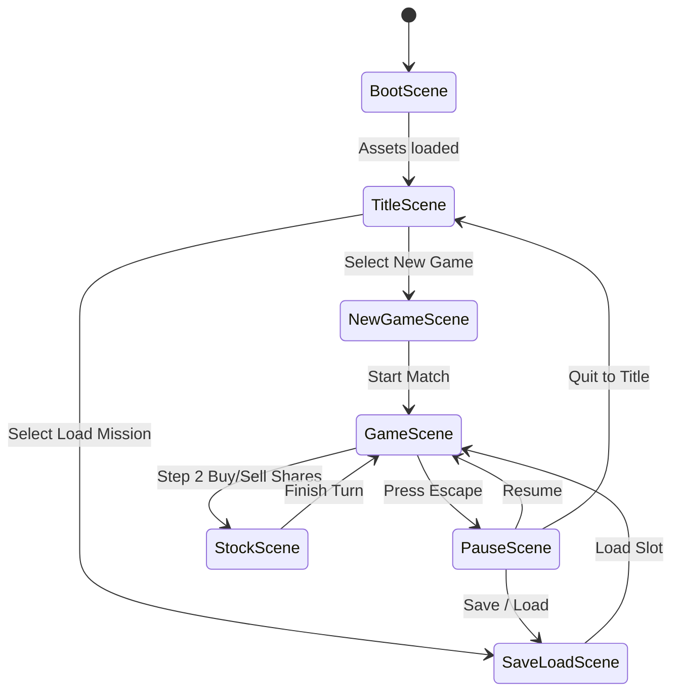

# Oil Baron Phaser 3 Game Architecture Specification

## 1. Executive Summary & Goals

This specification details the creation of a standalone, authentic canvas video game implementation of *Oil Baron* in a dedicated directory: `phasergame/`.
The project uses **Phaser 3** (`phaser@^3.88.2`), **Vite**, and **TypeScript**, reusing the verified, deterministic mathematical game engine in `webgame/src/engine/`.

### Core Game Experience:
1. **Classical Game Title Screen (`TitleScene`)**:
   - Retro/tactical game logo with dynamic oil pumpjack background animation.
   - Menu options: `NEW GAME`, `LOAD MISSION`, `OPTIONS`, `HOW TO PLAY`.
2. **Dedicated Game Scene (`GameScene`)**:
   - Pure canvas rendering (WebGL / Canvas fallback), locked viewport, zero web DOM/HTML form controls inside gameplay.
   - 10×12 Oil Basin Concession Map rendered via Phaser interactive game objects.
   - Smooth camera pan / zoom, well placement animations, pipeline connections, and particle feedback when striking oil.
   - Interactive bottom Concessions Dock with tactile lease chits and prominent drill actuator.
   - Step 2 Petroleum Equity Trading rendered natively inside the game canvas.
3. **Classical Pause / System Menu (`Escape` Key / `PauseScene`)**:
   - Pressing `Escape` at any point during gameplay pauses the simulation and opens a classical game pause overlay:
     - `RESUME GAME`
     - `NEW GAME`
     - `SAVE MISSION`
     - `LOAD MISSION`
     - `OPTIONS (AUDIO / DIFFICULTY)`
     - `QUIT TO TITLE SCREEN`
4. **Engine Reuse**:
   - Direct symbolic or shared import of `engine/` (`reducer.ts`, `board.ts`, `market.ts`, `ai.ts`, `persistence.ts`), guaranteeing 100% adherence to 1993 game rules, AI behavior, and save data compatibility.

---

## 2. Architecture & File Structure

```
phasergame/
├── package.json              # Phaser 3.88.2, Vite, TypeScript, Vitest
├── tsconfig.json
├── vite.config.ts
├── index.html                # Fullscreen canvas host
└── src/
    ├── main.ts               # Phaser game configuration & launch
    ├── assets/               # Audio, sound effects, sprite sheets
    ├── engine/               # Shared engine logic (symlink or copy of webgame/src/engine)
    ├── scenes/
    │   ├── BootScene.ts      # Asset preloading & audio initialization
    │   ├── TitleScene.ts     # Main Menu (New Game, Load, Options)
    │   ├── NewGameScene.ts   # Player roster configuration (2-6 players, AI toggles)
    │   ├── GameScene.ts      # Main Tactical Simulation canvas (Map, Dock, HUD)
    │   ├── PauseScene.ts     # Classical Escape Pause Menu overlay
    │   ├── StockScene.ts     # In-game equity trading & liquidation overlay
    │   └── SaveLoadScene.ts  # Slot-based persistence menu
    └── ui/
        ├── Button.ts         # Reusable Phaser game button with hover/click sounds
        ├── DialogBox.ts      # Canvas modal dialog container
        └── HudBar.ts         # Top operations HUD with player cash & net worth
```

---

## 3. Scenes & State Machine Flow



---

## 4. Verification & Acceptance Criteria
1. Project builds with 0 TypeScript errors (`npm run build`).
2. Unit tests verify engine integration and persistence (`npm test`).
3. Pressing `Escape` during gameplay opens the classical pause menu with full options to save, load, restart, or return to title.
